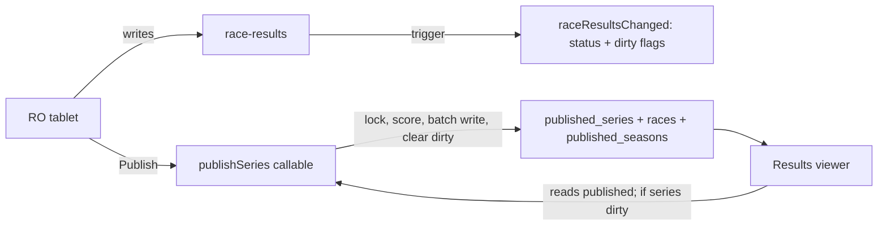

# Server-side scoring

## Decision
- **Explicit rescore:** the Publish button calls a server function.
- **Rescore on read:** when someone opens a series whose `dirty` flag is set, the viewer asks the server to republish it, while showing the current published results. The new results arrive through the existing listener.
- **Option B (score on every read) is ruled out.** No timer is needed; the read trigger covers anything the explicit request misses.
- **Firestore has no read triggers,** only write triggers. "On read" therefore means the viewer itself calls the callable when it sees the series is dirty. A `stale` flag on `published_series/{id}`, set by `raceResultsChanged`, would let the viewer see this through its existing listener.

## How it works today
- [`scoring-engine.ts`](sailbrowser-web/src/app/published-results/services/scoring-engine.ts) runs in the browser and publishes one series at a time.
- **Reads, mostly one after another:**
  - the series;
  - all its races;
  - every race result in the series (`getSeriesCompetitors`);
  - every series entry;
  - for each scoring configuration, its existing published races;
  - the season document.
- **Writes, in one batch:** for each scoring configuration (primary, secondary and separately scored divisions), the `published_series` doc and every published race doc. Then the season doc, and the cleared race `dirty` flags.
- **The scoring itself is pure TypeScript:** [`scoring/core/public-api.ts`](sailbrowser-web/src/app/scoring/core/public-api.ts) has no Angular dependencies.

## How fast would server scoring be?

Rough figures for a large series like Saturday 2025-26: 46 races, about 350 finishers, around 100 entries, three scoring configurations.

- **Scoring calculation:** tens of milliseconds. It's in-memory sorting and arithmetic over a few hundred rows, which tablets already do quickly.
- **Firestore reads:**
  - about 600–700 documents across 5–6 queries;
  - inside Google's network, and the queries can run in parallel on the server;
  - about 0.2–0.5 s.
- **Firestore writes:**
  - about 150 documents, because every published race is rewritten for each configuration;
  - one batch commit, about 0.3–0.6 s.
- **Total with the function already running:** about 0.5–1.5 s. Faster than today, where a tablet on club Wi-Fi downloads everything and uploads the batch.
- **Cold start:** add about 2–4 s for the first call after the function has been idle, since Node has to load `firebase-admin`. This can be avoided with `minInstances: 1` on the publish function.
- **Cost of `minInstances: 1`:** an idle warm instance is billed at about $0.0000025 per vCPU-second and per GiB-second (europe-west1 is Tier 1):
  - Firebase default of 1 vCPU and 256 MiB: about $8 (roughly £6) a month;
  - 1 vCPU and 512 MiB: about $9.70 a month;
  - `cpu: 0.5` and 256 MiB: about $4.90 a month.
- **Start without it:** the Publish button can show "Publishing…", and viewers see the current results straight away. Measure cold starts in use first, and add `minInstances` only if the wait bothers race officers.

So it's fast: about a second when the function is already running, a few seconds from cold. Two easy improvements:
- **Only write races that changed:** compare against the existing published races, which are already read. This cuts writes from about 150 to a few, typically the edited race plus any whose series points shifted.
- **Run the independent queries in parallel** rather than one after another.

## Design points for the read trigger
- **Only republish when the series is dirty:** clean series cost nothing extra when viewed.
- **One run per series:** the callable takes a short lock in a transaction on the series doc (for example `publishingAt`). Concurrent viewers then trigger one run, not many.
- **Who can trigger it:** viewers may be signed out. The callable only publishes series that are already dirty, so a stray call does no harm. Use App Check to discourage abuse.
- **Dirty flags are set on the server:** `raceResultsChanged` marks the race and series dirty on any result change. Kiosk entries, scans, imports and the mobile recorder are then all covered, without the client having to set the flag.
- **What viewers see:** the current published results straight away, then the updated ones once the run finishes. A "Results updating" hint is optional.

## Phased path
0. **Client quick wins, worth doing even before the move.** These are in [`scoring-engine.ts`](sailbrowser-web/src/app/published-results/services/scoring-engine.ts) and carry over unchanged to the server.
   - **Parallel reads:** fetch the races, race results, series entries, existing published races (per configuration) and season doc together with `Promise.all`, rather than one after another.
   - **Diff-based writes:**
     - Dirty flags still decide which series to publish.
     - The whole series is still rescored, because some race points depend on the whole series. When entries grow, non-finisher (DNC) points and series-size penalties such as SCP and ZFP change in every race, and average-points redress depends on other races.
     - Write only the published race docs whose content differs from what's already published, plus the series and season docs. Delete orphans as now.
     - Compare after normalising dates and Firestore timestamps and dropping undefined fields, so unchanged races don't look different.
1. **Extract the shared scoring package:** move `scoring/` and the models it needs into `shared/scoring`, compiled by both builds. Add tests checking that client and server give the same results.
2. **Server publish:** port `ScoringEngine` to the Admin SDK as `publishSeries(clubId, seriesId)`, behind a callable. Run the reads in parallel and only write changed races. The Publish button calls it.
3. **Server-set dirty flags:** extend `raceResultsChanged` to set race and series `dirty`.
4. **Republish on read:** the results viewer calls the callable for dirty series, with the lock above.
5. **Cut over:** make `published_*` server-write-only in the Firestore rules. Remove the client engine and the publishing in [`dirty-race.guard.ts`](sailbrowser-web/src/app/results-input/services/dirty-race.guard.ts) and `dirty-series-guard.ts`.
6. **Later:** retire the Dart scorer in `mobile-recorder`.

## Regression risk

The scoring rules themselves are low risk: the code is pure, has unit tests, and moves without changes. The risk is in the code around it, which reads data, writes it and builds the package:

- **Build tooling (medium):**
  - Functions compile as Node ESM (`NodeNext`), which needs `.js` extensions on imports and can't resolve the `app/...` path aliases at runtime.
  - Today `shared/contracts` is types only, so it never hit this.
  - The shared scoring code will need either bundling the functions with esbuild, or a separately built shared package.
- **Date types (medium):**
  - The client's Firestore converter turns Timestamps into JavaScript `Date`s.
  - The Admin SDK returns `Timestamp`s.
  - Scoring calls `.getTime()` and date-fns, so the server needs an equivalent converter or it will fail or misorder races.
- **Time zone (low to medium):**
  - Functions run in UTC; club tablets run in UK time.
  - `recentRaceCount6d` uses `startOfDay`.
  - Any date-based labels or day boundaries can shift by an hour during British Summer Time.
- **Undefined fields (low):** the Admin SDK rejects `undefined` values unless `ignoreUndefinedProperties` is turned on. The client converter quietly omits them.
- **Club settings (low):** the engine reads the club's long/short series defaults from the browser's `ClubStore`. The server must read the club doc instead.
- **The diff check (low to medium):** if the comparison wrongly says "unchanged", the change is never written and that race goes stale. Unit-test the comparison, and keep a "republish all" option.
- **Cutover (highest):** once `published_*` is server-only, a server failure means nothing publishes.

Mitigations:
- **Parity tests:** run the client and server engines on a copy of real club data in the emulator, and compare their outputs field by field.
- **Shadow mode:** for a few weeks the server also publishes to a parallel collection, for example `published_series_v2`, compared automatically against the client output. Only switch over and tighten the rules once they agree.
- **Fallback:** keep the client publish behind a switch until then.
